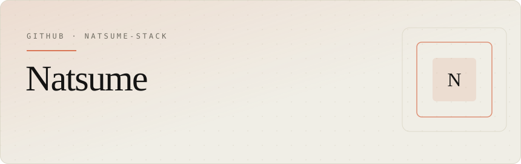
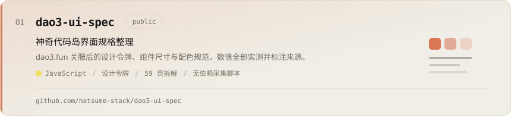
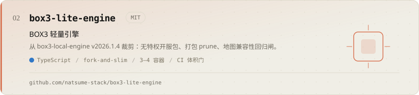
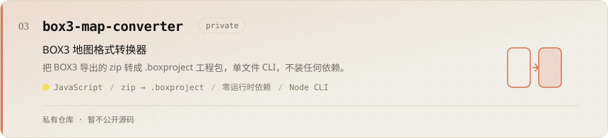
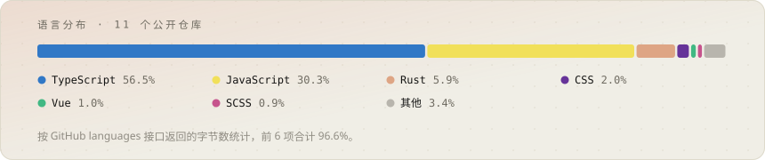

<picture>
  <source media="(prefers-color-scheme: dark)" srcset="assets/banner.dark.svg">
  
</picture>

<br>

做 Box3 / 神奇代码岛这一带的工具：引擎裁剪、地图格式转换、界面规格整理。偏好零依赖的 Node CLI 和能被机器读走的规范文档。

中文优先，Issue 里中英文都行。

### 项目

<a href="https://github.com/natsume-stack/dao3-ui-spec">
  <picture>
    <source media="(prefers-color-scheme: dark)" srcset="assets/card-dao3-ui-spec.dark.svg">
    
  </picture>
</a>

<a href="https://github.com/natsume-stack/box3-lite-engine">
  <picture>
    <source media="(prefers-color-scheme: dark)" srcset="assets/card-box3-lite-engine.dark.svg">
    
  </picture>
</a>

<picture>
  <source media="(prefers-color-scheme: dark)" srcset="assets/card-box3-map-converter.dark.svg">
  
</picture>

<br>

<details>
<summary>其他公开仓库</summary>

| 仓库 | 主要语言 | ★ | 最近推送 |
|---|---|---|---|
| [pixelops](https://github.com/natsume-stack/pixelops) | JavaScript | 0 | 2026-08-19 |
| [check](https://github.com/natsume-stack/check) | TypeScript | 1 | 2026-07-29 |
| [deepseek-codewhale-desktop](https://github.com/natsume-stack/deepseek-codewhale-desktop) | Rust | 0 | 2026-07-26 |
| [agora](https://github.com/natsume-stack/agora) | — | 0 | 2026-07-24 |
| [Network-verification](https://github.com/natsume-stack/Network-verification) | TypeScript | 0 | 2026-07-16 |
| [code-Kitty-im](https://github.com/natsume-stack/code-Kitty-im) | TypeScript | 1 | 2026-05-30 |
| [bettermaoIM](https://github.com/natsume-stack/bettermaoIM) | Vue | 1 | 2026-03-29 |
| [newbettermaoim](https://github.com/natsume-stack/newbettermaoim) | — | 0 | 2026-03-27 |

</details>

<details>
<summary>这些卡片是怎么来的</summary>

`assets/` 下的 SVG 全部由 `build/make-assets.js` 生成，内容取自 `build/data.json`，语言占比来自 GitHub `/languages` 接口的真实字节数。改文案或换仓库只动 `data.json`，然后：

```bash
node build/make-assets.js     # 重新生成 10 个 SVG（明暗各 5）
node build/check.js           # 拼一张检查图 build/check.html
```

没有构建依赖，不需要 `npm install`。

</details>

<br>

<picture>
  <source media="(prefers-color-scheme: dark)" srcset="assets/langbar.dark.svg">
  
</picture>
